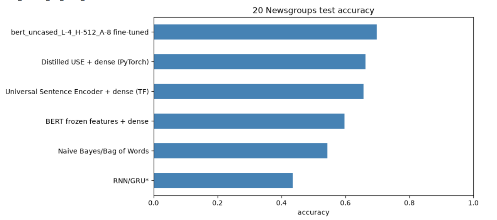

# NLP Evolution

I started this notebook as a demo for my SMU class. Many of our projects were becoming out of date as NLP rapidly transformed from 2015–2020. While that transformation (no pun intended) continues to this day, what I felt was important was to connect my students to those developments and show how "modern" NLP handles the projects we were practicing the "old school" way.

At the time, TensorFlow was the dominant framework, so my examples were in TensorFlow. In my job I migrated to PyTorch around 2021–2022, and as I lost touch with TensorFlow, the examples started to suffer from code rot and TensorFlow's habit of changing the API. Mind you, this was after the 1.x to 2.x transition. I got tired of fighting it and the notebook sat. I still taught basic TensorFlow, but the examples got old.

Fast forward: I was recently moving my teaching to all PyTorch, and this notebook was a thorn in my side. I really wanted to bring it back because it highlights a lot of the "hidden features" we take for granted now. For instance, when this notebook first formed, there was no BERT preprocessor. You learned how to use the BERT tokenizer and then how to mark your sentences. Setting up word dictionaries and word vectors is still part of modern LLMs, just hidden behind slick APIs. It's not a flex; I truly believe in studying right down to the fundamentals. So now it lives again after a brisk evening of repair.

## What this is

This notebook walks through, with my unique humor and sarcasm, a 20-class classifier using scikit-learn's 20 Newsgroups data. In class I taught a spam classifier, and it was pretty simple, with students often achieving scores of 99%. I wanted a harder problem to show the improvements from bag-of-words models, to early RNNs, then to transformers. It covers the 3 phases (according to me) of NLP:

+ Classic bag of words and traditional ML. Here a Naive Bayes, but any classifier will do.
+ RNNs. Neural networks got big in the 2010s, and RNNs were the way to go until 2017. Here I present a simple RNN: nothing crazy fancy, no attention, not bidirectional. Again, the point is to expose students to the basics.
+ Transformers. 2017 hit like a ton of bricks. "Attention Is All You Need" and BERT quickly changed the game (yes, ChatGPT as well).

The same problem is redone in all three phases and the results are compared. Surprise, surprise, surprise: the GRU/RNN landed last. I have been working on that result and it's still lagging, but as we say, NO FREE LUNCH. The GRU model had a lot working against it: limited vocab and tokenization (I did word tokenization by hand to show students what goes on behind the scenes). Naive Bayes's CountVectorizer strips punctuation and keeps the whole ~100k-word vocabulary, while the GRU gets 5,000 space-split words. I made some minor improvements, but it is still in last place. There are an obvious number of further improvements, but again, this is a demo, not a research paper.

There is a switch to PyTorch in the middle. The Universal Sentence Encoder and BERT (especially BERT) were broken by TensorFlow changes. USE got patched to run in TensorFlow again, but BERT I moved to PyTorch and Hugging Face, along with a PyTorch USE stand-in to show the equivalence. I got some help from Claude with the repairs. The switch mirrors what happened in industry: many of us migrated around this point. In 2018 TensorFlow Hub was "the thing"; now we have Hugging Face.

## Future work (not done yet)
Modern transformers: LoRA, RoPE, FlashAttention. Mainly LoRA and RoPE. You can look up FlashAttention, but it computes exactly the same attention, just FASTER, by being smarter about GPU memory. The notebook ends with a ModernBERT swap as a teaser, since RoPE and FlashAttention come built into that model.

Next I plan to do some true LLM tuning with the latest models using LoRA and similar techniques. That was the whole point of the transformer: scale. While the big kids play with hundreds of GPUs, this work can be done with a modest GPU. Mine is an older RTX 2070. I've been spoiled at work, so the home computer is a bit behind. But that's the point: you don't need big resources to experiment.

## Setup

It is best to have separate environments for TensorFlow and PyTorch, since their CUDA packages can conflict. Somehow I managed to get them both working in the same one. pyproject.toml has the requirements:

+ Python 3.12
+ jupyter>=1.1.1
+ matplotlib>=3.11.2
+ pandas>=3.1.1
+ pip>=26.3
+ scikit-learn>=1.9.1
+ sentence-transformers>=6.3.0
+ setuptools<81 (tensorflow_hub still imports pkg_resources, which setuptools removed in v82)
+ tensorflow[and-cuda]>=2.21.0
+ torch>=2.15.0
+ transformers>=5.24.0

What I ran with (not requirements): WSL2, NVIDIA driver 610.57.01, CUDA UMD version 13.3, RTX 2070 (8 GB).

If TensorFlow prints "Cannot dlopen some GPU libraries": add the venv's nvidia/*/lib folders to LD_LIBRARY_PATH. For Jupyter, set it in the kernel's kernel.json.

## Results

Looks bad for our poor friend the RNN/GRU but accuracy is a single number.  If you look at the confusion matrix, it did much better on the "confusing" categories.  In addition it was a very basic RNN - no bi-direction, sort of a hack tokenization. Its top 3 metric did approach 80 so its not as bad as it seems.  These categories have a LOT of overlap (check out the confusion matrices in the notebook). The is my PERSONAL opinion.  I actually tried to improve it with limited success (larger word vectors, better tokenization).  It could be NO FREE LUNCH, it could be I am just out of practice for RNNs.  Regardless this was a demo of how NLP evolved.

